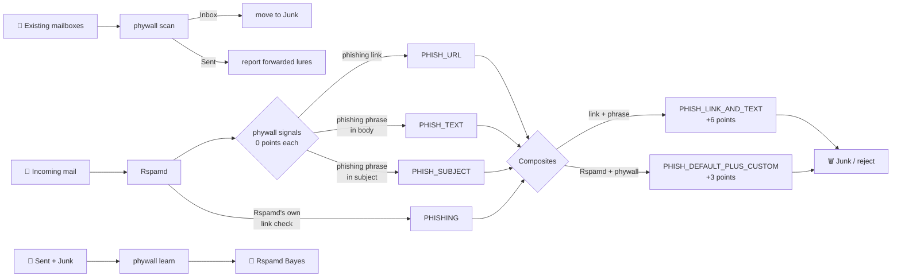

<p align="center">
  
</p>

<p align="center">
  
  
  
  
  <br>
  
  
  
  
</p>

<p align="center">
  <b>Finds phishing in your mailboxes, moves it to Junk, reports lures your staff forwarded,<br>
  and teaches Rspamd to catch the next wave.</b>
</p>

<p align="center">
  <a href="#-installation">Installation</a> •
  <a href="#-quick-start">Quick start</a> •
  <a href="#-commands">Commands</a> •
  <a href="#-sectors">Sectors</a> •
  <a href="#-faq">FAQ</a> •
  <a href="#-contributing">Contributing</a> •
  <a href="#-security">Security</a> •
  <a href="#-license--credits">License & Credits</a>
</p>

---

## 🛡️ What is phywall?

**phywall** is a command-line toolkit for mail servers running **Rspamd + Dovecot**. It adds phishing detection rules to Rspamd, cleans phishing out of existing mailboxes, tells you which employees forwarded a phishing mail, and trains Rspamd's Bayes filter from the mail your staff actually sent and received.

It was built on a real hotel mail server that received fake *Booking.com* complaints, "bed bug" lures, fake sign-in alerts and CEO-fraud mails every day.

- 🎣 **Phrase + link detection:** 1,100+ phishing phrases in **16 languages**, split into **12 business sectors**
- 🧹 **Mailbox cleanup:** scans an Inbox and moves phishing to Junk, with a dry run first
- 🕵️ **Forwarded-lure report:** finds phishing your staff forwarded to colleagues (who may have clicked)
- 🧠 **Bayes training:** learns ham from *Sent*, spam from *Junk*, and refuses to learn forwarded phishing as ham
- 🤝 **Shared defense:** one command shares what phywall found, so the next release protects every server
- ↩️ **Safe by design:** dry run by default, backups, automatic restore, one-command rollback

---

## ⚙️ How it works



## 🎯 The scoring logic

A single signal is never enough to punish a mail. Points only come when **two different kinds of evidence** agree.

| Rule | Points | Fires when |
|---|:---:|---|
| `PHISH_URL` | **0** | A link points to a hosting or redirect service known from phishing (`share.google`, `workers.dev`, …) |
| `PHISH_TEXT` | **0** | The body contains a known phishing phrase |
| `PHISH_SUBJECT` | **0** | The subject contains a known phishing phrase |
| `PHISH_LINK_AND_TEXT` | **+6** | Phishing link **and** phishing phrase in the same mail |
| `PHISH_DEFAULT_PLUS_CUSTOM` | **+3** | Rspamd's own `PHISHING` (link text ≠ real link) **and** a phywall signal |

> [!TIP]
> A real guest who sends a Google Maps `share.google` link gets **0 points**. The same link next to *"Guest complaint – review photo evidence"* gets **+6**.

---

## 📋 Requirements

| Component | Notes |
|---|---|
| 🐧 **Linux** | Tested on AlmaLinux 9 (RHEL 9 family). Other distributions should work but are not tested yet |
| 📮 **Rspamd** | With `rspamc` and `rspamadm`, and a working controller |
| 🗄️ **Redis** | Used by Rspamd for Bayes and greylisting |
| 📬 **Dovecot** | Maildir layout: `/var/mail/vhosts/<domain>/<user>/` with `.Sent` and `.Junk` folders (only `scan` and `learn` need it) |
| 🔧 **Tools** | `bash`, `awk`, `sed`, `grep`, `find`, `iconv`, `base64`, `curl`, `tar` (all standard) |

> [!NOTE]
> Using a different mail path? Set it before running: `export MAILBASE=/your/mail/path`

---

## 🚀 Installation

```bash
curl -L https://github.com/develust/phywall/releases/latest/download/phywall.tar.gz | tar xz
cd phywall
sudo ./install.sh
```

This always downloads the **latest release**, installs phywall to `/opt/phywall` and creates the `phywall` command. No git needed on the server.

```bash
phywall version
phywall help
```

---

## ⚡ Quick start

**1. See the available sectors**
```bash
phywall configure --sectors
```

**2. Dry run: see what would change in Rspamd**
```bash
phywall configure --sector hotel,finance
```

**3. Install the rules**
```bash
phywall configure --sector hotel,finance --apply
```

**4. Clean an existing mailbox** (dry run first, then move)
```bash
phywall scan info@example.com
phywall scan info@example.com --move
```

**5. Train Bayes**
```bash
phywall learn example.com
phywall learn example.com --learn --exclude tech,webmaster
```

---

## 📖 Commands

### Setup
| Command | What it does |
|---|---|
| `phywall configure --sector hotel,finance` | Dry run: shows what would change |
| `phywall configure --sector hotel,finance --apply` | Installs maps and Rspamd rules |
| `phywall configure --rollback` | Removes everything `configure` added |
| `phywall configure --sectors` | Lists available sectors |

### Scanning
| Command | What it does |
|---|---|
| `phywall scan user@domain` | Dry run: Inbox + Sent report |
| `phywall scan user@domain --move` | Moves Inbox phishing to Junk. Sent is **only reported**, never moved |

### Bayes training
| Command | What it does |
|---|---|
| `phywall learn domain` | Dry run: all accounts of the domain |
| `phywall learn user@domain` | Dry run: one account |
| `phywall learn domain --learn` | Trains Bayes: **Sent → ham, Junk → spam** |
| `--days N` | Only mails from the last N days (fast repeat runs) |
| `--exclude a,b,c` | Skip accounts, e.g. `tech,webmaster,services` |

### Contribute
| Command | What it does |
|---|---|
| `phywall contribute` | Shows exactly what phywall would share (nothing is sent) |
| `phywall contribute --apply` | Sends it to Develust to improve the maps for everyone |
| `phywall contribute --clear` | Deletes all contribution data stored on this server |

### Tool
| Command | What it does |
|---|---|
| `phywall update` | Checks GitHub for a newer version |
| `phywall update --apply` | Installs it and reloads your sectors into Rspamd |
| `phywall uninstall` | Rolls back Rspamd, saves logs, removes phywall |
| `phywall version` / `phywall help` | Version / command list |

---

## 🏭 Sectors

`common` is always installed. Pick one or more sectors for your organization: `--sector hotel,travel`.

| Sector | Phrases | Typical lures |
|---|:---:|---|
| 🌐 `common` | 203 | Mailbox full, password expiry, shared documents, fake sign-in alerts, parcel delivery |
| 🏨 `hotel` | 139 | Fake Booking.com complaints, bed bugs, lost items, fake cancellations, extranet login |
| ✈️ `travel` | 87 | Ticket cancellation, visa rejection, GDS alerts, supplier bank changes |
| 🏦 `finance` | 107 | SWIFT copies, blocked cards, tax refunds, CEO fraud |
| 🚚 `logistics` | 78 | Bills of lading, customs holds, courier impersonation |
| 🛒 `ecommerce` | 84 | Seller account suspension, chargebacks, IP complaints |
| 🏭 `manufacturing` | 69 | Fake purchase orders, "ready to order" + video meeting lures |
| 🏥 `healthcare` | 69 | Lab results, patient portals, insurance claims |
| 🎓 `education` | 75 | Student portals, scholarships, staff payroll lures |
| 🏛️ `government` | 76 | Court summons, fines, e-government accounts |
| ⚖️ `legal` | 69 | Case files, escrow changes, inheritance scams |
| 💻 `it` | 74 | Domain expiry scams, SSL, hosting suspension, M365 alerts |

**Languages in every sector:** English, Spanish, German, French, Italian, Portuguese, Dutch, Polish, Turkish, Azerbaijani, Russian, Ukrainian, Arabic, Hindi, Chinese, Thai.

---

## 🖥️ Example output

<details open>
<summary><b>phywall scan</b>: Inbox cleanup + Sent report</summary>

```text
===== Inbox =====
[1] MOVED OK
  From:    Booking.com <m.omori@ygd.co.jp>
  Subject: New last-minute booking (5831264205, Tuesday, August 7, 2025)
  Score:   10.86 / 15.00
  Rules:   PHISH_URL (0.00)[share.google]
           PHISH_TEXT (0.00)
           PHISH_LINK_AND_TEXT (6.00)

===== Sent (report only - never moved) =====
[S1] FORWARDED PHISHING
  To:      fo@example.com
  Subject: Fwd: Booking Request: Standard Double Room (18–22 August 2026)
  Rules:   PHISH_LINK_AND_TEXT (6.00), PHISHING (2.00)

-----
Inbox: scanned 1241, found 12, moved 12, errors 0
Sent:  scanned 312, suspicious 1
  -> Check with info@example.com and the recipients: fo@example.com
     (did they click the link or enter a password?)
```
</details>

<details>
<summary><b>phywall learn</b>: Bayes training</summary>

```text
  [1/6] fo     Sent   ham    learned 52   skipped 0   too short 7   suspicious 0   errors 0
  [1/6] fo     Junk   spam   learned 2    skipped 0   too short 10  errors 0
-----
Learned: 3656   Skipped (already learned): 27   Too short: 590   Suspicious (not learned): 2   Errors: 0
Bayes before: ham 2178  spam 912
Bayes after:  ham 5633  spam 1207
```
</details>

---

## 🔒 Safety by design

> [!NOTE]
> **Every command is a dry run by default.** Nothing changes until you add `--apply`, `--move` or `--learn`.

> [!IMPORTANT]
> `configure --apply` **backs up** your Rspamd files first, writes its rules as a **marked block** at the end of `local.d/multimap.conf` and `local.d/composites.conf`, enables the **OpenPhish** and **PhishTank** feeds if they are off, and runs `rspamadm configtest`. If the test fails, or if any existing Rspamd rule disappears, **everything is restored automatically**.

> [!WARNING]
> **Sent mail is never moved**, only reported. Moving staff mail to Junk would teach Bayes that your own domain is spam.

> [!CAUTION]
> phywall **never learns Inbox mail as ham**. Inboxes are full of unwanted marketing mail, and unremoved phishing would poison Bayes.

**What phywall changes on your server, and nothing else:**

```
/opt/phywall/                            the tool, logs, backups, contribution queue
/usr/local/bin/phywall                   the command (a link)
/etc/rspamd/maps/phishing/               urls.map + text/<sector>.map
/etc/rspamd/local.d/multimap.conf        marked block at the end
/etc/rspamd/local.d/composites.conf      marked block at the end
/etc/rspamd/local.d/phishing.conf        marked block at the end (only if OpenPhish / PhishTank were off)
```

`phywall configure --rollback` removes exactly the Rspamd parts. `phywall uninstall` removes everything.

---

## 🔄 Update & uninstall

```bash
phywall update             # check for a newer version
phywall update --apply     # install it and reload your sectors into Rspamd
phywall uninstall          # rollback + save logs to /root + remove phywall
```

Updates come from **GitHub Releases**. Your logs, backups and installed sectors are kept.

---

## ❓ FAQ

<details>
<summary><b>Why does a phishing link alone give 0 points?</b></summary>

Real people use the same services. A guest sending a Google Maps `share.google` link, or a partner sharing a Dropbox file, must not land in Junk. A link only counts together with a phishing phrase or Rspamd's own link check.
</details>

<details>
<summary><b>Why are there no points for a phishing phrase alone?</b></summary>

Real mail contains the same words. A real Booking.com cancellation, a real Google "new sign-in" alert, a real guest complaint. Phrases are signals, and only a second, different kind of evidence turns them into points.
</details>

<details>
<summary><b>Does phywall ban IP addresses like fail2ban?</b></summary>

No. It detects, moves to Junk, reports and trains. Blocking is left to Rspamd's scores and your existing policy.
</details>

<details>
<summary><b>Why not learn from the Inbox?</b></summary>

Inboxes are full of marketing mail people never asked for, and may still contain phishing. *Sent* (written by your staff) and *Junk* (confirmed spam) are decided by humans, so they are clean training data.
</details>

<details>
<summary><b>What is the "Sent report"?</b></summary>

A phishing mail in *Sent* means an employee forwarded it, believing it was real. They, and the colleague who received it, may have clicked the link. `phywall scan` lists sender, recipients, subject and date so you know whom to check.
</details>

<details>
<summary><b>What does "too short" mean in <code>learn</code>?</b></summary>

Bayes needs at least 11 words. Attachment-only mails ("see attached") are skipped by Rspamd. This is harmless.
</details>

<details>
<summary><b>Does phywall send anything without asking?</b></summary>

No. Data only leaves your server when you run `phywall contribute --apply` yourself, after seeing the preview. See [Contributing](#-contributing).
</details>

<details>
<summary><b>Is running <code>learn</code> twice a problem?</b></summary>

No. Rspamd remembers every learned mail by fingerprint and skips it the second time.
</details>

---

## 🤝 Contributing

Phishing changes every week. A new template shows up, a few hundred servers receive it, and every one of them fights it alone. phywall gets better when we fight it **together**: what one server catches today can protect all the others in the next release.

There are two ways to help. Pick whichever fits you.

### 1. Share what phywall found (one command)

Every time you run `phywall scan`, phywall quietly remembers the phishing it found. When you're ready, send it to us:

```bash
phywall contribute            # look first: shows everything that would be sent
phywall contribute --apply    # send it
```

That's all. No mail files to download, no attachments, no forms. We look at what comes in, turn new tricks into new phrases and rules, and ship them in the next release, so `phywall update` brings them to everyone.

**What gets shared, and why**

| Shared | Why we need it |
|---|---|
| The phishing sender (name, address, envelope sender) | To check it against reputation services and spot repeat campaigns |
| The subject | New phrases for the sector maps |
| Score and the rules that fired | To see which rules work and which need tuning |
| Link hosts (only the host, never the path) | New entries for `urls.map`, and to check with URL scanners |
| The full text, **only for mails scoring 10 or more** | Real lures are how we write good new rules |
| A copy count | "This reached 4 mailboxes" tells us how big a campaign is, without saying which ones |

**What never leaves your server**

- ❌ Your users' addresses. They become `[recipient]`
- ❌ Your own domains. They become `[own-domain]`
- ❌ Phone numbers, booking numbers and other long numbers. They become `#`
- ❌ Link paths and tokens (`https://evil.com/x7k2?id=…` becomes `evil.com`)
- ❌ Attachments, images, HTML
- ❌ Anything about the server itself: no hostname, no IP, no mailbox names, no version of your OS or Rspamd

> [!IMPORTANT]
> **You always see it before we do.** `phywall contribute` without `--apply` prints the whole report, and the exact JSON is saved to `/opt/phywall/contribute/preview.json`. Nothing is sent until you add `--apply`.

> [!NOTE]
> Cleaning is automatic but not magic: a company *name* written as plain text (for example "Alba Hotel") can't be recognized as yours. That's exactly why the preview exists. If something looks too personal, don't send it.

**A few more things you might want to know**

- **Nothing is automatic.** phywall never sends anything on its own. No cron, no background job, no "phone home".
- **Each phishing is sent once.** The same campaign in five mailboxes becomes one entry with `copies: 5`, and nothing is sent twice.
- **Anonymous by design.** The first `--apply` gets a random token from our API (stored in `/opt/phywall/contribute/.token`). It isn't linked to your server, name or domain; it only lets us block abuse. Our API doesn't store your IP address or hostname. (Like any site behind Cloudflare, Cloudflare's own security logs briefly record the IP of requests they block.)
- **We only use it to fight phishing.** Reports are reviewed by Develust, and only what we confirm makes it into the maps. Nothing is sold or shared with third parties.
- **Your data, your choice.** Everything phywall collected stays on your server until you send it, and you can delete all of it at any time:

  ```bash
  phywall contribute --clear
  ```

  This removes the collected mails and the list of what was already sent. phywall asks for confirmation first (`--yes` skips the question, useful in scripts). The anonymous token stays, so your server keeps the same random ID and doesn't register again. It contains nothing about you or your server. To drop it too, delete `/opt/phywall/contribute/.token`; the next `--apply` gets a fresh one.

### 2. Improve the maps or the code

Found a lure phywall misses? Open a pull request with a new phrase or URL, one regex per line, in `maps/text/<sector>.map` or `maps/urls.map`:

```
/guest\s+complaint\s+regarding\s+(a\s+)?recent\s+stay/i
/(^|\.)workers\.dev$/i
```

A few rules keep the maps healthy:

1. Use `\s+` between words, `/i` for case-insensitive, `/iu` for non-Latin text
2. **No trailing spaces.** Rspamd 4.x silently ignores those lines
3. Match what the lure **asks you to do**, not normal business words ("invoice attached" is far too common)
4. Test your phrase against a few normal mails before opening the pull request
5. Put it in the right language section of the right sector

Bugs, ideas, or a false positive that annoyed you? Tell us in [Issues](../../issues). Every report helps.

---

## 🔐 Security

Found a vulnerability in phywall or in our API? Please **don't open a public issue**. Write to **tech@develust.com** instead, encrypted with our OpenPGP key if you can.

| | |
|---|---|
| **Email** | `tech@develust.com` |
| **Fingerprint** | `8641 BC59 A857 FF1C DF96  EDD1 9C24 CAA3 2329 DA3D` |
| **Key** | [keys.openpgp.org](https://keys.openpgp.org/search?q=tech%40develust.com) |

Import it:

```bash
gpg --keyserver hkps://keys.openpgp.org --recv-keys 8641BC59A857FF1CDF96EDD19C24CAA32329DA3D
```

or download it directly:

```bash
curl -s https://keys.openpgp.org/vks/v1/by-fingerprint/8641BC59A857FF1CDF96EDD19C24CAA32329DA3D | gpg --import
```

Always compare the fingerprint with the one above before trusting the key. We'll answer as quickly as we can and credit you in the release notes if you'd like.

---

## 🇦🇿 Azərbaycanca

**phywall** Rspamd + Dovecot istifadə edən poçt serverləri üçün fişinq əleyhinə alətdir. 12 sahə üzrə, 16 dildə 1100-dən çox fişinq ifadəsi ilə Rspamd-ə qaydalar əlavə edir, mövcud poçt qutularında fişinq məktublarını tapıb *Junk* qovluğuna köçürür, əməkdaşların başqalarına yönləndirdiyi fişinq məktublarını hesabat şəklində göstərir və Bayes filtrini öyrədir.

**Quraşdırma:**
```bash
curl -L https://github.com/develust/phywall/releases/latest/download/phywall.tar.gz | tar xz
cd phywall && sudo ./install.sh
```

**Əsas əmrlər:**
| Əmr | Nə edir |
|---|---|
| `phywall configure --sector hotel --apply` | Rspamd qaydalarını quraşdırır |
| `phywall scan info@domain.az --move` | Inbox-dakı fişinqi Junk-a köçürür |
| `phywall learn domain.az --learn` | Bayes-i öyrədir (Sent → ham, Junk → spam) |
| `phywall configure --rollback` | Əlavə olunan hər şeyi geri qaytarır |
| `phywall contribute --apply` | Tapılan fişinqi Develust ilə paylaşır (əvvəlcə `phywall contribute` ilə nəyin göndəriləcəyinə baxın) |
| `phywall contribute --clear` | Serverdə toplanmış bütün töhfə məlumatlarını silir |

Bütün əmrlər əvvəlcə **sınaq rejimində** işləyir və heç nəyi dəyişmir. Dəyişiklik üçün `--apply`, `--move` və ya `--learn` əlavə edin.

**Töhfə vermək:** `phywall contribute` yalnız phywall-un tapdığı fişinqi göstərir, `--apply` ilə göndərir. İstifadəçi ünvanları, öz domenləriniz, nömrələr və server haqqında heç bir məlumat göndərilmir. Heç nə avtomatik göndərilmir.

Sual və təkliflər üçün: **support@develust.com**
Təhlükəsizlik problemləri üçün: **tech@develust.com** (OpenPGP açarı yuxarıda)

---

## 📜 License & credits

Released under the **[MIT License](LICENSE)**.

Built and maintained by **[Develust Technology](https://develust.com)**, Baku 🇦🇿
Support: **support@develust.com** · Security: **tech@develust.com**

<p align="center"><sub>If phywall caught a phishing mail for you, consider giving the repo a ⭐</sub></p>
