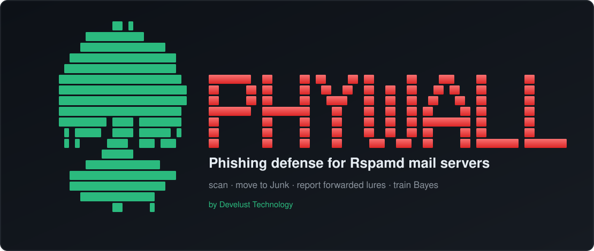
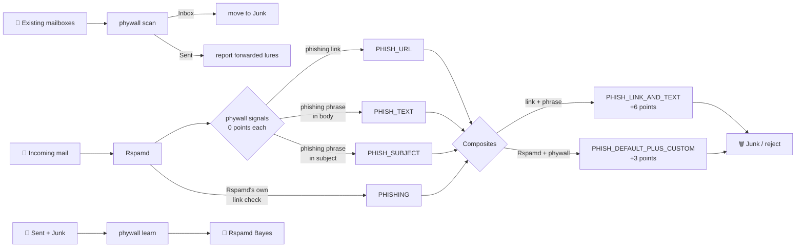

<p align="center">
  
</p>

<p align="center">
  
  
  
  
  <br>
  
  
  
  
</p>

<p align="center">
  <b>Finds phishing in your mailboxes, moves it to Junk, reports lures your staff forwarded,<br>
  and teaches Rspamd to catch the next wave.</b>
</p>

<p align="center">
  <a href="#-installation">Installation</a> •
  <a href="#-quick-start">Quick start</a> •
  <a href="#-commands">Commands</a> •
  <a href="#-sectors">Sectors</a> •
  <a href="#-faq">FAQ</a> •
  <a href="#-azərbaycanca">Azərbaycanca</a>
</p>

---

## 🛡️ What is phywall?

**phywall** is a command-line toolkit for mail servers running **Rspamd + Dovecot**. It adds phishing detection rules to Rspamd, cleans phishing out of existing mailboxes, tells you which employees forwarded a phishing mail, and trains Rspamd's Bayes filter from the mail your staff actually sent and received.

It was built on a real hotel mail server that received fake *Booking.com* complaints, "bed bug" lures, fake sign-in alerts and CEO-fraud mails every day.

- 🎣 **Phrase + link detection:** 1,100+ phishing phrases in **16 languages**, split into **12 business sectors**
- 🧹 **Mailbox cleanup:** scans an Inbox and moves phishing to Junk, with a dry run first
- 🕵️ **Forwarded-lure report:** finds phishing your staff forwarded to colleagues (who may have clicked)
- 🧠 **Bayes training:** learns ham from *Sent*, spam from *Junk*, and refuses to learn forwarded phishing as ham
- ↩️ **Safe by design:** dry run by default, backups, automatic restore, one-command rollback

---

## ⚙️ How it works



## 🎯 The scoring logic

A single signal is never enough to punish a mail. Points only come when **two different kinds of evidence** agree.

| Rule | Points | Fires when |
|---|:---:|---|
| `PHISH_URL` | **0** | A link points to a hosting or redirect service known from phishing (`share.google`, `workers.dev`, …) |
| `PHISH_TEXT` | **0** | The body contains a known phishing phrase |
| `PHISH_SUBJECT` | **0** | The subject contains a known phishing phrase |
| `PHISH_LINK_AND_TEXT` | **+6** | Phishing link **and** phishing phrase in the same mail |
| `PHISH_DEFAULT_PLUS_CUSTOM` | **+3** | Rspamd's own `PHISHING` (link text ≠ real link) **and** a phywall signal |

> [!TIP]
> A real guest who sends a Google Maps `share.google` link gets **0 points**. The same link next to *"Guest complaint – review photo evidence"* gets **+6**.

---

## 📋 Requirements

| Component | Notes |
|---|---|
| 🐧 **Linux** | Tested on AlmaLinux 9 (RHEL 9 family). Other distributions should work but are not tested yet |
| 📮 **Rspamd** | With `rspamc` and `rspamadm`, and a working controller |
| 🗄️ **Redis** | Used by Rspamd for Bayes and greylisting |
| 📬 **Dovecot** | Maildir layout: `/var/mail/vhosts/<domain>/<user>/` with `.Sent` and `.Junk` folders (only `scan` and `learn` need it) |
| 🔧 **Tools** | `bash`, `awk`, `sed`, `grep`, `find`, `iconv`, `base64`, `curl`, `tar` (all standard) |

> [!NOTE]
> Using a different mail path? Set it before running: `export MAILBASE=/your/mail/path`

---

## 🚀 Installation

```bash
curl -L https://github.com/develust/phywall/releases/latest/download/phywall.tar.gz | tar xz
cd phywall
sudo ./install.sh
```

This always downloads the **latest release**, installs phywall to `/opt/phywall` and creates the `phywall` command. No git needed on the server.

```bash
phywall version
phywall help
```

---

## ⚡ Quick start

**1. See the available sectors**
```bash
phywall configure --sectors
```

**2. Dry run: see what would change in Rspamd**
```bash
phywall configure --sector hotel,finance
```

**3. Install the rules**
```bash
phywall configure --sector hotel,finance --apply
```

**4. Clean an existing mailbox** (dry run first, then move)
```bash
phywall scan info@example.com
phywall scan info@example.com --move
```

**5. Train Bayes**
```bash
phywall learn example.com
phywall learn example.com --learn --exclude tech,webmaster
```

---

## 📖 Commands

### Setup
| Command | What it does |
|---|---|
| `phywall configure --sector hotel,finance` | Dry run: shows what would change |
| `phywall configure --sector hotel,finance --apply` | Installs maps and Rspamd rules |
| `phywall configure --rollback` | Removes everything `configure` added |
| `phywall configure --sectors` | Lists available sectors |

### Scanning
| Command | What it does |
|---|---|
| `phywall scan user@domain` | Dry run: Inbox + Sent report |
| `phywall scan user@domain --move` | Moves Inbox phishing to Junk. Sent is **only reported**, never moved |

### Bayes training
| Command | What it does |
|---|---|
| `phywall learn domain` | Dry run: all accounts of the domain |
| `phywall learn user@domain` | Dry run: one account |
| `phywall learn domain --learn` | Trains Bayes: **Sent → ham, Junk → spam** |
| `--days N` | Only mails from the last N days (fast repeat runs) |
| `--exclude a,b,c` | Skip accounts, e.g. `tech,webmaster,services` |

### Tool
| Command | What it does |
|---|---|
| `phywall update` | Checks GitHub for a newer version |
| `phywall update --apply` | Installs it and reloads your sectors into Rspamd |
| `phywall uninstall` | Rolls back Rspamd, saves logs, removes phywall |
| `phywall version` / `phywall help` | Version / command list |

---

## 🏭 Sectors

`common` is always installed. Pick one or more sectors for your organization: `--sector hotel,travel`.

| Sector | Phrases | Typical lures |
|---|:---:|---|
| 🌐 `common` | 203 | Mailbox full, password expiry, shared documents, fake sign-in alerts, parcel delivery |
| 🏨 `hotel` | 139 | Fake Booking.com complaints, bed bugs, lost items, fake cancellations, extranet login |
| ✈️ `travel` | 87 | Ticket cancellation, visa rejection, GDS alerts, supplier bank changes |
| 🏦 `finance` | 107 | SWIFT copies, blocked cards, tax refunds, CEO fraud |
| 🚚 `logistics` | 78 | Bills of lading, customs holds, courier impersonation |
| 🛒 `ecommerce` | 84 | Seller account suspension, chargebacks, IP complaints |
| 🏭 `manufacturing` | 69 | Fake purchase orders, "ready to order" + video meeting lures |
| 🏥 `healthcare` | 69 | Lab results, patient portals, insurance claims |
| 🎓 `education` | 75 | Student portals, scholarships, staff payroll lures |
| 🏛️ `government` | 76 | Court summons, fines, e-government accounts |
| ⚖️ `legal` | 69 | Case files, escrow changes, inheritance scams |
| 💻 `it` | 74 | Domain expiry scams, SSL, hosting suspension, M365 alerts |

**Languages in every sector:** English, Spanish, German, French, Italian, Portuguese, Dutch, Polish, Turkish, Azerbaijani, Russian, Ukrainian, Arabic, Hindi, Chinese, Thai.

---

## 🖥️ Example output

<details open>
<summary><b>phywall scan</b>: Inbox cleanup + Sent report</summary>

```text
===== Inbox =====
[1] MOVED OK
  From:    Booking.com <m.omori@ygd.co.jp>
  Subject: New last-minute booking (5831264205, Tuesday, August 7, 2025)
  Score:   10.86 / 15.00
  Rules:   PHISH_URL (0.00)[share.google]
           PHISH_TEXT (0.00)
           PHISH_LINK_AND_TEXT (6.00)

===== Sent (report only - never moved) =====
[S1] FORWARDED PHISHING
  To:      fo@example.com
  Subject: Fwd: Booking Request: Standard Double Room (18–22 August 2026)
  Rules:   PHISH_LINK_AND_TEXT (6.00), PHISHING (2.00)

-----
Inbox: scanned 1241, found 12, moved 12, errors 0
Sent:  scanned 312, suspicious 1
  -> Check with info@example.com and the recipients: fo@example.com
     (did they click the link or enter a password?)
```
</details>

<details>
<summary><b>phywall learn</b>: Bayes training</summary>

```text
  [1/6] fo     Sent   ham    learned 52   skipped 0   too short 7   suspicious 0   errors 0
  [1/6] fo     Junk   spam   learned 2    skipped 0   too short 10  errors 0
-----
Learned: 3656   Skipped (already learned): 27   Too short: 590   Suspicious (not learned): 2   Errors: 0
Bayes before: ham 2178  spam 912
Bayes after:  ham 5633  spam 1207
```
</details>

---

## 🔒 Safety by design

> [!NOTE]
> **Every command is a dry run by default.** Nothing changes until you add `--apply`, `--move` or `--learn`.

> [!IMPORTANT]
> `configure --apply` **backs up** your Rspamd files first, writes its rules as a **marked block** at the end of `local.d/multimap.conf` and `local.d/composites.conf`, and runs `rspamadm configtest`. If the test fails, or if any existing Rspamd rule disappears, **everything is restored automatically**.

> [!WARNING]
> **Sent mail is never moved**, only reported. Moving staff mail to Junk would teach Bayes that your own domain is spam.

> [!CAUTION]
> phywall **never learns Inbox mail as ham**. Inboxes are full of unwanted marketing mail, and unremoved phishing would poison Bayes.

**What phywall changes on your server, and nothing else:**

```
/opt/phywall/                            the tool, logs, backups
/usr/local/bin/phywall                   the command (a link)
/etc/rspamd/maps/phishing/               urls.map + text/<sector>.map
/etc/rspamd/local.d/multimap.conf        marked block at the end
/etc/rspamd/local.d/composites.conf      marked block at the end
```

`phywall configure --rollback` removes exactly the Rspamd parts. `phywall uninstall` removes everything.

---

## 🔄 Update & uninstall

```bash
phywall update             # check for a newer version
phywall update --apply     # install it and reload your sectors into Rspamd
phywall uninstall          # rollback + save logs to /root + remove phywall
```

Updates come from **GitHub Releases**. Your logs, backups and installed sectors are kept.

---

## ❓ FAQ

<details>
<summary><b>Why does a phishing link alone give 0 points?</b></summary>

Real people use the same services. A guest sending a Google Maps `share.google` link, or a partner sharing a Dropbox file, must not land in Junk. A link only counts together with a phishing phrase or Rspamd's own link check.
</details>

<details>
<summary><b>Why are there no points for a phishing phrase alone?</b></summary>

Real mail contains the same words. A real Booking.com cancellation, a real Google "new sign-in" alert, a real guest complaint. Phrases are signals, and only a second, different kind of evidence turns them into points.
</details>

<details>
<summary><b>Does phywall ban IP addresses like fail2ban?</b></summary>

No. It detects, moves to Junk, reports and trains. Blocking is left to Rspamd's scores and your existing policy.
</details>

<details>
<summary><b>Why not learn from the Inbox?</b></summary>

Inboxes are full of marketing mail people never asked for, and may still contain phishing. *Sent* (written by your staff) and *Junk* (confirmed spam) are decided by humans, so they are clean training data.
</details>

<details>
<summary><b>What is the "Sent report"?</b></summary>

A phishing mail in *Sent* means an employee forwarded it, believing it was real. They, and the colleague who received it, may have clicked the link. `phywall scan` lists sender, recipients, subject and date so you know whom to check.
</details>

<details>
<summary><b>What does "too short" mean in <code>learn</code>?</b></summary>

Bayes needs at least 11 words. Attachment-only mails ("see attached") are skipped by Rspamd. This is harmless.
</details>

<details>
<summary><b>Is running <code>learn</code> twice a problem?</b></summary>

No. Rspamd remembers every learned mail by fingerprint and skips it the second time.
</details>

---

## 🤝 Contributing

New phishing templates appear every week. **The best contribution is a new phrase or URL from a real phishing mail you received.**

**Map format:** one regex per line, in `maps/text/<sector>.map` or `maps/urls.map`:

```
/guest\s+complaint\s+regarding\s+(a\s+)?recent\s+stay/i
/(^|\.)workers\.dev$/i
```

**Rules:**
1. Use `\s+` between words, `/i` for case-insensitive, `/iu` for non-Latin text
2. **No trailing spaces** (Rspamd 4.x silently ignores such lines)
3. Match what the lure **asks you to do**, not normal business words ("invoice attached" is too common)
4. Test your phrase against a few normal mails before opening a pull request
5. Put the phrase in the right language section of the right sector

Bug reports and ideas are welcome in [Issues](../../issues).

---

## 🇦🇿 Azərbaycanca

**phywall** Rspamd + Dovecot istifadə edən poçt serverləri üçün fişinq əleyhinə alətdir. 12 sahə üzrə, 16 dildə 1100-dən çox fişinq ifadəsi ilə Rspamd-ə qaydalar əlavə edir, mövcud poçt qutularında fişinq məktublarını tapıb *Junk* qovluğuna köçürür, əməkdaşların başqalarına yönləndirdiyi fişinq məktublarını hesabat şəklində göstərir və Bayes filtrini öyrədir.

**Quraşdırma:**
```bash
curl -L https://github.com/develust/phywall/releases/latest/download/phywall.tar.gz | tar xz
cd phywall && sudo ./install.sh
```

**Əsas əmrlər:**
| Əmr | Nə edir |
|---|---|
| `phywall configure --sector hotel --apply` | Rspamd qaydalarını quraşdırır |
| `phywall scan info@domain.az --move` | Inbox-dakı fişinqi Junk-a köçürür |
| `phywall learn domain.az --learn` | Bayes-i öyrədir (Sent → ham, Junk → spam) |
| `phywall configure --rollback` | Əlavə olunan hər şeyi geri qaytarır |

Bütün əmrlər əvvəlcə **sınaq rejimində** işləyir və heç nəyi dəyişmir. Dəyişiklik üçün `--apply`, `--move` və ya `--learn` əlavə edin.

Sual və təkliflər üçün: **support@develust.com**

---

## 📜 License & credits

Released under the **[MIT License](LICENSE)**.

Built and maintained by **[Develust Technology](https://develust.com)**, 
Support: **support@develust.com**

<p align="center"><sub>If phywall caught a phishing mail for you, consider giving the repo a ⭐</sub></p>
